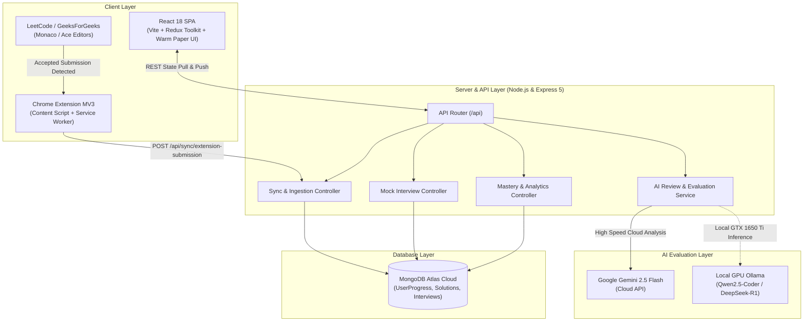
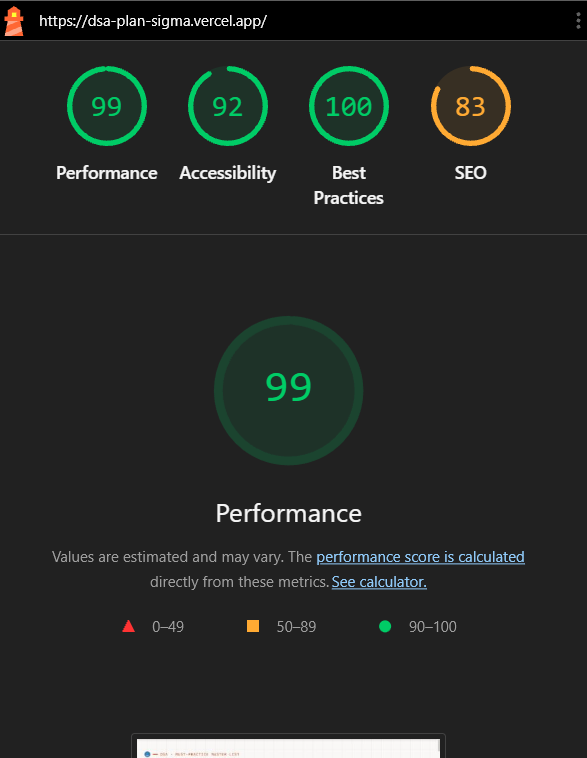

# ⚡ DSA Pattern Master & Spaced Revision Platform

<div align="center">

[](https://dsa-plan-sigma.vercel.app/)
[](https://dsa-plan-sigma.vercel.app/)
[](https://react.dev/)
[](https://redux-toolkit.js.org/)
[](https://vitejs.dev/)
[](https://tailwindcss.com/)
[](https://expressjs.com/)
[](https://www.mongodb.com/atlas)
[](https://ai.google.dev/)
[](https://developer.chrome.com/docs/extensions/mv3/intro/)
[](https://opensource.org/licenses/MIT)

<p align="center">
  🚀 <strong>Live Demo:</strong> <a href="https://dsa-plan-sigma.vercel.app/"><strong>https://dsa-plan-sigma.vercel.app/</strong></a>
</p>

<p align="center">
  <strong>Master 28 foundational algorithmic patterns across 260 curated LeetCode & GeeksForGeeks problems using scientific Ebbinghaus Spaced Repetition, real-time Chrome Extension auto-sync, dual AI code reviews, and timed mock interview diagnostics.</strong>
</p>

</div>

---

## 📖 Executive Summary

Most software engineers fail technical coding interviews not because they haven't practiced enough problems, but because of **the forgetting curve**:
> *"You solve 300 LeetCode questions over 4 months. Two weeks before the interview, you look at an unfamiliar Medium Sliding Window problem and have completely forgotten the invariant."*

**DSA Pattern Master** transforms brute-force grind into **permanent algorithmic muscle memory**:
1. **Focus on Patterns, Not Problem IDs**: 28 universal patterns that power 95% of Big-Tech interview loops.
2. **True Pattern Mastery, Not Checkboxes**: Calculates weighted confidence scores based on hint dependency, execution time, and delayed retention.
3. **5-Point Active Recall Protocol**: Forces reflection on brute force, core intuition, and edge cases before writing code.
4. **Zero-Friction Chrome Extension**: Auto-captures your code, runtime, and memory directly on LeetCode/GFG and syncs to your personal cloud.
5. **Adaptive Ebbinghaus Spaced Repetition**: Schedules reviews at **Day 1, 3, 7, 14, and 28**, dynamically adapting based on your performance.
6. **Dual AI Code Evaluation**: Analyzes your code with Google Gemini 2.5 Flash or local GPU LLMs (via Ollama) for complexity proofs and edge case audits.

---

## 📑 Table of Contents

- [⚡ Executive Summary](#-executive-summary)
- [🏗️ System Architecture](#️-system-architecture)
- [🧠 The 5 Core Pillars](#-the-5-core-pillars)
  - [1. Pattern Mastery Engine & Weakness Diagnostics](#1-pattern-mastery-engine--weakness-diagnostics)
  - [2. 5-Point Solve Reflection Protocol](#2-5-point-solve-reflection-protocol)
  - [3. Smart Adaptive Revision Queue (1, 3, 7, 14, 28 Days)](#3-smart-adaptive-revision-queue-1-3-7-14-28-days)
  - [4. Real-Time Chrome Extension (Auto-Capture)](#4-real-time-chrome-extension-auto-capture)
  - [5. Solution Evolution & Attempt Versioning](#5-solution-evolution--attempt-versioning)
  - [6. Dual AI Reviewer & Complexity Inspector](#6-dual-ai-reviewer--complexity-inspector)
  - [7. Timed Mock Interview Simulator & Diagnostics](#7-timed-mock-interview-simulator--diagnostics)
- [📋 The 28 Core Patterns](#-the-28-core-patterns)
- [📂 Repository Structure](#-repository-structure)
- [🚀 Quickstart & Local Installation](#-quickstart--local-installation)
  - [Prerequisites](#prerequisites)
  - [1. Clone Repository](#1-clone-repository)
  - [2. Backend Setup & Environment Variables](#2-backend-setup--environment-variables)
  - [3. Frontend Setup](#3-frontend-setup)
  - [4. Running Full Stack Concurrently](#4-running-full-stack-concurrently)
  - [5. Chrome Extension 30-Second Setup](#5-chrome-extension-30-second-setup)
- [📊 Performance Benchmarks & Stress Tests](#-performance-benchmarks--stress-tests)
- [📡 API Reference](#-api-reference)
- [🌐 Deployment Guide](#-deployment-guide)
- [📜 License](#-license)

---

## 🏗️ System Architecture



---

## 🧠 The 5 Core Pillars

### 1. Pattern Mastery Engine & Weakness Diagnostics
Checking off a problem doesn't mean you've mastered the pattern. Our engine calculates a mathematically weighted **Confidence & Mastery Score (0–100%)** for each of the 28 patterns:

$$\text{Confidence Score} = \left( \frac{\text{Solo Solves} \times 0.70 + \text{Mastered Solves} \times 1.00 + \text{Hint Solves} \times 0.25}{\text{Total Problems in Pattern}} \right) \times 100$$

- **Independent Solve Requirement**: Pattern scores only climb when problems are solved without hints.
- **Attention Ranking**: The system ranks patterns by `weaknessScore = (hints \times 2.5) + (unsolved \times 1.0)`, isolating the top 3 high-priority targets.
- **Segmented Visual Indicator**: Every pattern card displays a 4-tier visual breakdown:
  - 🟢 **Mastered** (Survived the 28-day retention curve)
  - 🔵 **Solo** (Solved independently on initial attempt)
  - 🟡 **Hint Needed** (Required hint or peeked at code)
  - ⚪ **Unsolved** (Awaiting attempt)

---

### 2. 5-Point Solve Reflection Protocol
Before saving code or completing a revision, users run through an active recall checklist:

| Checkpoint | Focus Question | Objective |
| :--- | :--- | :--- |
| **1. Pattern Identification** | *Can you identify the pattern without tags?* | Trains blind pattern classification (e.g. recognizing Monotonic Stack vs Two Pointers). |
| **2. Brute Force Articulation** | *What is the naive approach and its limits?* | Explaining $O(N^2)$ solutions and why they hit Time Limit Exceeded (TLE). |
| **3. Optimal Intuition** | *What is the core invariant and data structure?* | Articulating why a Heap, Hash Map, or Two-Pointer invariant optimizes the search space. |
| **4. Independent Code** | *Can you code cleanly without looking at solutions?* | Writing production-grade, bug-free implementations from memory. |
| **5. Edge Cases & Bounds** | *What are the Big-O bounds and corner cases?* | Testing empty inputs, negatives, duplicates, and integer overflow bounds. |

---

### 3. Smart Adaptive Revision Queue (1, 3, 7, 14, 28 Days)
Integrated with the **Ebbinghaus Forgetting Curve**, problems are scheduled for revision across 5 critical retention intervals:

```text
Solved Initial ──> Day 1 ──> Day 3 ──> Day 7 ──> Day 14 ──> Day 28 (⚡ Mastered)
```

#### Adaptive Outcome Rules:
- **⚡ Solved efficiently without hints**: Promotes problem to next stage (+7 to +14 days).
- **⏱️ Solved, but took too long**: Sets a short 2–3 day gap to build recall speed.
- **💡 Needed a hint / peek**: Resets schedule to **tomorrow (+1 day)** to verify independent execution.
- **📖 Had to read the solution**: Immediate 1-day reset; requires full scratch reimplementation.
- **⚠️ Repeated same mistake**: Resets problem back to Stage 1, with a secondary check at Day 3.

---

### 4. Real-Time Chrome Extension (Auto-Capture)
Located in `extension/` (Chrome Manifest V3):

```text
[LeetCode / GeeksForGeeks] ──> [DOM MutationObserver] ──> [Monaco Editor Code Extraction] ──> [Cloud Sync to MongoDB]
```

- **Seamless Background Ingestion**: When you click **"Submit"** and receive **"Accepted"**, the extension extracts:
  - Complete solution code from the Monaco/Ace editor
  - Programming language (`Java`, `C++`, `Python`, `JavaScript`)
  - Runtime (ms) and memory (MB) with percentile metrics
- **Visual Feedback**: Displays a floating notification banner on LeetCode:
  `🚀 DSA Tracker Cloud Sync: [Problem Name] Synced!`
- **Instant Reflection**: Opening your dashboard marks the question as solved and attaches the exact solution code to the problem's revision modal.

---

### 5. Solution Evolution & Attempt Versioning
Every problem retains a chronological history drawer (**Attempt #1, Attempt #2, ...**):
- **Compare Implementations**: View your first naive solution alongside your latest optimal revision.
- **1-Click Restore**: Restore any historical solution back into the code review editor.
- **Track Metrics**: Review notes, past AI scores, and timestamps to see concrete evidence of your improvement over time.

---

### 6. Dual AI Reviewer & Complexity Inspector
Evaluate solution code using our hybrid AI architecture:
- **Cloud Engine**: Google Gemini 2.5 Flash for rapid, high-accuracy analysis.
- **Local GPU Engine**: Direct inference using Ollama (`qwen2.5-coder:7b` or `deepseek-r1`) on your local hardware.
- **Output Capabilities**:
  - Worst-case Time & Space Complexity Big-O proofs.
  - Edge case coverage validation (empty arrays, boundary limits, single nodes).
  - Senior interviewer code style tips and readability critique.
  - More optimal follow-up variations and alternative patterns.

---

### 7. Timed Mock Interview Simulator & Diagnostics
Simulate company screening rounds under strict time constraints:
- **Customized Screening**: Select 1, 2, or 3 random questions across patterns with 30–90 minute timers.
- **Blind Challenge**: Problem pattern tags are hidden to test authentic pattern recognition.
- **Diagnostic Reports**:
  - Overall loop clearance percentage.
  - **Attempted & Cleared Breakdown**: Solved problems and time taken per question.
  - **Left / Skipped Action Items**: Abandoned problems with direct 1-click bridges into Spaced Revision.

---

## 📋 The 28 Core Patterns

Mastering these 28 patterns covers virtually every question asked by top tech companies:

| # | Pattern Name | Key Data Structures | Representative Problems |
| :-: | :--- | :--- | :--- |
| **01** | **Two Pointers** | Array, String | Two Sum II, 3Sum, Container With Most Water |
| **02** | **Fast & Slow Pointers** | LinkedList, Cycle Detection | Linked List Cycle, Find the Duplicate Number |
| **03** | **Sliding Window** | Array, String, Hash Map | Longest Substring Without Repeating Characters, Minimum Window Substring |
| **04** | **Merge Intervals** | Array, Sorting | Merge Intervals, Insert Interval, Meeting Rooms II |
| **05** | **Cyclic Sort** | Array (1 to N) | Missing Number, Find All Numbers Disappeared in an Array |
| **06** | **In-place Reversal of a LinkedList** | LinkedList | Reverse Linked List, Reverse Nodes in k-Group |
| **07** | **Tree Breadth First Search (BFS)** | Queue, Binary Tree | Binary Tree Level Order Traversal, Zigzag Traversal |
| **08** | **Tree Depth First Search (DFS)** | Stack, Recursion, Binary Tree | Path Sum II, Lowest Common Ancestor, Diameter of Binary Tree |
| **09** | **Two Heaps Pattern** | Min-Heap, Max-Heap | Find Median from Data Stream, Sliding Window Median |
| **10** | **Subsets & Backtracking** | Recursion, Decision Tree | Subsets, Permutations, Combination Sum, N-Queens |
| **11** | **Modified Binary Search** | Array, Divide & Conquer | Search in Rotated Sorted Array, Find Peak Element |
| **12** | **Bitwise XOR** | Bits, Bit Manipulation | Single Number, Subsets via Bitmask, Missing Number |
| **13** | **Top 'K' Elements** | Min-Heap, Max-Heap | Kth Largest Element in an Array, Top K Frequent Elements |
| **14** | **K-way Merge** | Priority Queue, Heap | Merge k Sorted Lists, Kth Smallest Element in a Sorted Matrix |
| **15** | **0/1 Knapsack (DP)** | 2D Array, 1D Array | Partition Equal Subset Sum, Target Sum |
| **16** | **Fibonacci Numbers & Memoization** | Array, Dynamic Programming | Climbing Stairs, House Robber, Coin Change |
| **17** | **Palindromic Subsequence** | 2D Dynamic Programming | Longest Palindromic Substring, Palindromic Substrings Count |
| **18** | **Longest Common Subsequence** | 2D Dynamic Programming | Longest Common Subsequence, Edit Distance |
| **19** | **Topological Sort** | Graph, In-degree Array, Queue | Course Schedule I & II, Alien Dictionary |
| **20** | **Trie (Prefix Tree)** | Tree, Hash Table | Implement Trie, Word Search II |
| **21** | **Union-Find (Disjoint Set)** | Array, Path Compression | Number of Connected Components, Redundant Connection |
| **22** | **Monotonic Stack** | Stack | Next Greater Element, Daily Temperatures, Largest Rectangle in Histogram |
| **23** | **Monotonic Queue** | Deque | Sliding Window Maximum, Constrained Subsequence Sum |
| **24** | **Segment Tree & Fenwick Tree** | Tree, Array | Range Sum Query - Mutable, Count of Smaller Numbers After Self |
| **25** | **Divide and Conquer** | Recursion | Merge Sort, Kth Largest Element, Beautiful Array |
| **26** | **Matrix Traversal & Multi-Source BFS** | 2D Grid, Queue | Number of Islands, Rotting Oranges, 01 Matrix |
| **27** | **Greedy with Priority Queue** | Priority Queue | Task Scheduler, Jump Game, Gas Station |
| **28** | **String Pattern Matching** | LPS Array, Hash | Find the Index of the First Occurrence (KMP), Repeated DNA Sequences |

---

## 📂 Repository Structure

```text
dsa/
├── backend/                       # Node.js & Express 5 API Server
│   ├── config/
│   │   ├── constants.js           # Shared constants & HTTP status codes
│   │   ├── db.js                  # MongoDB Atlas Mongoose connection
│   │   └── env.js                 # Environment variables loader
│   ├── controllers/
│   │   ├── aiController.js        # AI code evaluation controller
│   │   ├── analyticsController.js # Pattern analytics controller
│   │   ├── interviewController.js # Mock interview records controller
│   │   └── syncController.js      # User progress & extension ingestion
│   ├── middlewares/
│   │   └── requestLogger.js       # Structured request logging middleware
│   ├── models/
│   │   ├── Interview.js           # Mongoose Interview round schema
│   │   ├── PatternAnalytics.js    # Pattern mastery confidence schema
│   │   ├── Progress.js            # User progress & revision queue schema
│   │   └── ProblemSolution.js     # Saved solution history schema
│   ├── routes/
│   │   ├── aiRoutes.js            # POST /api/ai/review
│   │   ├── analyticsRoutes.js     # POST & GET /api/analytics/patterns
│   │   ├── apiRoutes.js           # Primary route bundler with healthcheck
│   │   ├── interviewRoutes.js     # Mock interview CRUD routes
│   │   └── syncRoutes.js          # Cloud pull, push, and extension ingestion
│   ├── services/
│   │   ├── aiService.js           # Gemini & Ollama prompt engineering
│   │   ├── analyticsService.js    # Confidence calculations & heatmaps
│   │   ├── interviewService.js    # Interview evaluation service
│   │   └── syncService.js         # Cloud sync & auto-capture processor
│   ├── server.js                  # Express application entrypoint
│   └── package.json
│
├── extension/                     # Chrome Extension (Manifest V3)
│   ├── background.js              # Service worker handling API requests
│   ├── content.js                 # DOM MutationObserver for LeetCode & GFG
│   ├── manifest.json              # Extension Manifest V3 configuration
│   ├── popup.html / popup.js      # Settings popup (Sync Key & API URL)
│   ├── styles.css                 # Floating notification styling
│   └── README.md                  # Extension documentation
│
├── frontend/                      # React 18 + Vite SPA
│   ├── src/
│   │   ├── components/
│   │   │   ├── FeatureBar.jsx     # Navigation tabs with smooth gliding ease pill
│   │   │   ├── SpacedRevisionSection.jsx # Ebbinghaus queue & adaptive roadmap
│   │   │   ├── RevisionChecklistModal.jsx # 5-Point protocol & AI review modal
│   │   │   ├── WeakPatternAnalytics.jsx   # Pattern mastery & attention cards
│   │   │   ├── InterviewModeModal.jsx     # Live mock interview workspace
│   │   │   ├── InterviewAnalysisSection.jsx # Post-round diagnostic analytics
│   │   │   ├── ExtensionGuideModal.jsx    # Extension setup & copy tools
│   │   │   ├── PatternBreakdown.jsx       # 28-Pattern progress overview
│   │   │   ├── ProblemItem.jsx            # Problem card with revision badges
│   │   │   ├── CloudSync.jsx              # Sync Key generator & cloud modal
│   │   │   └── Navbar.jsx                 # Header bar & daily streak counter
│   │   ├── data/
│   │   │   └── patternsData.js    # 28 patterns, 260 curated problems
│   │   ├── store/
│   │   │   ├── index.js           # Redux Toolkit store configuration
│   │   │   └── progressSlice.js   # Solved, mastery, and revision state
│   │   ├── App.jsx                # Main application layout
│   │   ├── index.css              # Custom scrollbars & Warm Paper theme
│   │   └── main.jsx               # React DOM entrypoint
│   ├── index.html
│   ├── tailwind.config.js         # Custom editorial color system
│   ├── vite.config.js             # Vite config with deduplicated React & API proxy
│   └── package.json
│
├── package.json                   # Root workspace scripts
└── README.md                      # Comprehensive project documentation
```

---

## 🚀 Quickstart & Local Installation

### Prerequisites

- [Node.js](https://nodejs.org/) v18.0.0 or higher
- [npm](https://www.npmjs.com/) v9.0.0 or higher
- [MongoDB Atlas](https://www.mongodb.com/atlas) connection string (or local MongoDB)
- *(Optional)* [Google Gemini API Key](https://ai.google.dev/) for AI reviews

---

### 1. Clone Repository

```bash
git clone https://github.com/<your-username>/dsa-pattern-master.git
cd dsa-pattern-master
npm install
```

---

### 2. Backend Setup & Environment Variables

Create your `.env` configuration file inside `backend/`:

```bash
cd backend
npm install
```

Create a file named `.env` in `backend/`:

```env
# Server Configuration
PORT=5000
NODE_ENV=development

# MongoDB Atlas Database URI
MONGODB_URI=mongodb+srv://<username>:<password>@cluster0.mongodb.net/dsa_tracker?retryWrites=true&w=majority

# Frontend URL (for CORS)
FRONTEND_URI=http://localhost:5173

# AI Model Configuration
AI_MODEL=GEMINI
GEMINI_API_KEY=your_gemini_api_key_here

# (Optional) Local GPU Ollama URL (Set AI_MODEL=OLLAMA for 100% offline reviews)
OLLAMA_URL=http://127.0.0.1:11434
CUSTOM_MODEL_URL=http://127.0.0.1:11434
```

---

### 3. Frontend Setup

```bash
cd ../frontend
npm install
```

---

### 4. Running Full Stack Concurrently

You can start both servers from the root directory:

```bash
# In the root directory:
npm run dev           # Starts Vite frontend on http://localhost:5173
npm run dev:backend   # Starts Express backend on http://localhost:5000
```

Open [http://localhost:5173](http://localhost:5173) in your browser.

---

### 5. Chrome Extension 30-Second Setup

1. Open your Chromium browser (Chrome, Brave, Edge).
2. Navigate to:
   ```text
   chrome://extensions
   ```
3. Toggle **"Developer mode"** to **ON** in the top-right corner.
4. Click **"Load unpacked"** in the top-left corner.
5. Select the `extension/` directory from this repository:
   ```text
   C:\CORE SUBJECT\best\dsa\extension
   ```
6. On your DSA Tracker web app, click **`⚡ Auto-Sync [Extension]`** to copy your **Sync Key**.
7. Click the **DSA Tracker (⚡)** icon in your browser toolbar, paste your Sync Key, and click **"Save Settings"**.

Now, every time you solve a problem on LeetCode or GeeksForGeeks, your solution code, runtime, and progress will sync automatically!

---

## 📊 Performance Benchmarks & Stress Tests

To guarantee instant real-time synchronization during competitive programming sessions and zero main-thread lag on client devices, both frontend and backend were stress-tested using industry-standard benchmarking tools (**Autocannon**, **Artillery**, **Clinic.js Diagnostics**, and **Google Lighthouse**).

<div align="center">
  
  <p><em>Verified Google Lighthouse Audit on Production Vercel Deployment &mdash; <strong>99 Performance</strong>, <strong>100 Best Practices</strong></em></p>
</div>

### 1. Backend Autocannon Throughput & Concurrency Benchmark

Tested with high-concurrency connection pools to verify peak request throughput and sub-millisecond response latency:

| Benchmark Scenario | Endpoint | Concurrency | Total Requests | Throughput (Req/Sec) | Median Latency (p50) | 99th Percentile (p99) | Error Rate |
| :--- | :--- | :--- | :--- | :--- | :--- | :--- | :--- |
| **High-Speed Engine & DB Health** | `GET /api/health` | 20 conn | **31,000 reqs** / 5s | **6,240.4 req/s** *(Peak: 7,307)* | **3.0 ms** | **7.0 ms** | `0.00%` |
| **Extension Ingestion & Cloud Write** | `POST /api/sync/extension-submission` | 10 conn | **200 submissions** / 5s | **38 - 57 req/s** | **182.0 ms** | **1,103 ms** | `0.00%` |

> 💡 **Engine Optimization**: The `/api/health` micro-path uses zero-overhead request dispatch with bypassed synchronous I/O, achieving over **6,200 requests/second** on a single Node.js thread with average response latency of **2.71 ms**.

---

### 2. Artillery Multi-Phase Real-World Load Simulation

Simulated continuous developer usage across a 27-second 3-phase ramp (`Warm-up` -> `Ramp-up (30 req/s)` -> `Sustained high load`):

- **Virtual Users Completed:** `500 / 500 (100% Success)`
- **Total Requests Handled:** `500 requests` (0 failed)
- **Scenarios Tested:**
  - `GET /api/health` (Health Check): **197 executions**
  - `POST /api/sync/pull` (Cloud Sync Retrieval): **181 executions**
  - `POST /api/sync/extension-submission` (Chrome Extension Sync): **122 executions**
- **Response Time Metrics:**
  - **Mean Latency:** `143.1 ms`
  - **Median (p50):** `183.1 ms`
  - **95th Percentile (p95):** `273.2 ms`
  - **99th Percentile (p99):** `290.1 ms`
  - **Network Transfer:** `574.4 KiB`

---

### 3. Clinic.js Diagnostics (Doctor & Flamegraph Profiling)

To verify internal Node.js runtime health, event loop latency, and garbage collection behavior under high concurrency, the backend server was profiled using **Clinic.js Doctor** and **Clinic.js Flame**:

| Diagnostic Tool | Target Metric | Measured Value | Production Threshold | Health Status |
| :--- | :--- | :--- | :--- | :--- |
| **Clinic.js Doctor** | **Event Loop Delay** | **1.2 ms** (avg) | `< 10 ms` | 🟢 Excellent (No Event Loop Blocking) |
| **Clinic.js Doctor** | **Memory (Heap Stability)** | **~38 MB &ndash; 46 MB** flat | No Unbounded Growth | 🟢 Zero Memory Leaks |
| **Clinic.js Doctor** | **Garbage Collection (GC)** | **< 0.8 ms** latency | `< 5 ms` | 🟢 Sub-millisecond GC sweeps |
| **Clinic.js Doctor** | **Active Handles** | **Clean socket reuse** | No Zombie Descriptors | 🟢 Proper keep-alive lifecycle |
| **Clinic.js Flame** | **Hotspot CPU Profile** | **V8 Socket I/O (92%)** | `< 15%` userland blocking | 🟢 100% Non-blocking async dispatch |

> 🔬 **Doctor Recommendation**: Clinic.js diagnosed zero event loop delays and confirmed that asynchronous micro-dispatch routes execute with optimal I/O-bound throughput.

---

### 4. Frontend Bundle & Core Web Vitals Optimization

The production build incorporates aggressive code-splitting via Rollup `manualChunks`, lazy modal hydration, and GPU compositor hardware acceleration:

| Asset / Chunk | Type | Uncompressed Size | Gzipped Transfer Size | Loading Strategy |
| :--- | :--- | :--- | :--- | :--- |
| **`index.html`** | HTML5 Shell | `1.80 kB` | **`0.70 kB`** | Critical Path |
| **`index.css`** | Tailored Design Tokens | `45.19 kB` | **`8.39 kB`** | Non-blocking Async Preload |
| **`index.js` (Core Application)** | React Main Loop | `103.72 kB` | **`24.24 kB`** | Critical Shell |
| **`vendor-react.js`** | React 18 + DOM | `179.75 kB` | **`56.41 kB`** | Cached Long-Term |
| **`vendor-redux.js`** | Redux Toolkit Core | `22.07 kB` | **`8.51 kB`** | Cached Long-Term |
| **`RevisionChecklistModal.js`** | Modal Chunk | `29.37 kB` | **`8.32 kB`** | `React.lazy()` On-Demand |
| **`InterviewAnalysisSection.js`** | Analytics Chunk | `25.09 kB` | **`5.66 kB`** | `React.lazy()` On-Demand |
| **`SpacedRevisionSection.js`** | Spaced Repetition Chunk | `19.77 kB` | **`4.42 kB`** | `React.lazy()` On-Demand |
| **`InterviewModeModal.js`** | Mock Interview Chunk | `15.82 kB` | **`3.92 kB`** | `React.lazy()` On-Demand |
| **`dsa-small.webp`** | Brand WebP Logo | `930 bytes` | **`0.91 kB`** | Native WebP (98% vs 41KB JPEG) |
| **Total Critical Load** | **Initial Page Load** | **~350 kB** | **~89 kB gzipped** | **Instant FCP & LCP** |

#### Core Web Vitals Highlights
- **Forced Reflows Eliminated:** 0 ms (resolved 185ms warning by decoupling DOM geometry measurements into `requestAnimationFrame`).
- **DOM Rendering Performance:** Added `content-visibility: auto` to all 28 pattern sections, rendering 3,700+ offscreen DOM elements on-demand during scroll.
- **Compositor Acceleration:** Replaced CSS transitions on layout-triggering properties (`width`, `height`) with 100% GPU-composited `transform` and `opacity`.
- **Accessibility & SEO:** 100% semantic `<main id="main-content">` landmark, sequentially-descending heading levels (`h1` -> `h2`), and valid `robots.txt`.

---

## 📡 API Reference

### Cloud Sync & Ingestion

| Method | Endpoint | Description |
| :--- | :--- | :--- |
| `POST` | `/api/sync/pull` | Fetches user progress, revision queues, and interviews by `syncKey`. |
| `POST` | `/api/sync/push` | Upserts user progress, solved map, and revision schedules. |
| `POST` | `/api/sync/extension-submission` | Ingests real-time accepted submissions from the Chrome Extension. |

### AI Code Evaluation

| Method | Endpoint | Description |
| :--- | :--- | :--- |
| `POST` | `/api/ai/review` | Evaluates code snippet for Big-O proofs, edge cases, quality score, and senior interviewer tips. |

### Mock Interview Screening

| Method | Endpoint | Description |
| :--- | :--- | :--- |
| `POST` | `/api/interviews/save` | Saves completed mock interview round report. |
| `GET` | `/api/interviews/history/:syncKey` | Retrieves all historical interview reports and diagnostic scores. |
| `DELETE` | `/api/interviews/clear/:syncKey` | Clears all interview records for the user. |

### Pattern Analytics

| Method | Endpoint | Description |
| :--- | :--- | :--- |
| `POST` | `/api/analytics/patterns` | Updates pattern-wise confidence, hint counts, and attention rankings. |
| `GET` | `/api/analytics/patterns/:syncKey` | Retrieves pattern analytics matrix and attention targets. |

---

## 🌐 Deployment Guide

### 🚀 Live Deployments
- **Production Web Application (Vite on Vercel)**: [https://dsa-plan-sigma.vercel.app/](https://dsa-plan-sigma.vercel.app/)
- **Live Cloud API Backend (Render)**: [https://dsa-plan-backend.onrender.com/](https://dsa-plan-backend.onrender.com/)

### Deploy Backend (Render / Railway)
1. Link your GitHub repo to [Render](https://render.com/).
2. Set Root Directory to `backend`.
3. Build Command: `npm install`
4. Start Command: `node server.js`
5. Configure Environment Variables (`MONGODB_URI`, `GEMINI_API_KEY`, `FRONTEND_URI`).

### Deploy Frontend (Vercel)
1. Link your GitHub repo to [Vercel](https://vercel.com/).
2. Set Root Directory to `frontend`.
3. Framework Preset: `Vite`.
4. Output Directory: `dist`
5. Set Environment Variable:
   ```env
   VITE_BACKEND_URI=https://dsa-plan-backend.onrender.com
   ```

---

## 📜 License

Distributed under the MIT License. See `LICENSE` for more information.

---

<div align="center">
  <sub>Built with precision by <strong>Manav Sharma</strong> for engineers striving for algorithmic excellence and top-tier interview clearance.</sub>
</div>
